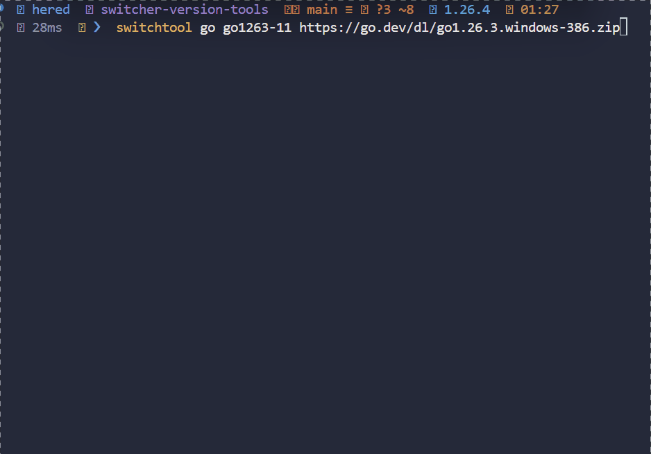

# switchtool - Gestor de Entornos para Windows 🚀


**switchtool** es un CLI potente y minimalista diseñado para desarrolladores que necesitan cambiar rápidamente entre versiones de sus herramientas favoritas en Windows. Olvida configurar el %PATH% manualmente o pelear con variables de entorno cada vez que cambias de proyecto.

## 🌟 Herramientas Soportadas

- **Java** (JDK)
- **Maven**
- **Gradle**
- **PHP**
- **Go** (GOROOT)
- **Node.js**
- **pnpm** (PNPM_HOME)

## ✨ Características

- **Descarga Automática**: Soporta URLs directas (Adoptium, Apache, etc.) o archivos locales.
- **Formatos Soportados**: Extrae automáticamente archivos `.zip`, `.tar.gz` y `.tgz`.
- **Gestión Inteligente de PATH**: Automatiza la limpieza y actualización del PATH de usuario mediante PowerShell.
- **Variables de Entorno**: Setea automáticamente `JAVA_HOME`, `MAVEN_HOME`, `GRADLE_HOME`, `PHP_HOME`, `GOROOT`, `NODE_HOME`, y `PNPM_HOME`.
- **Detección de Directorios**: Si el archivo comprimido tiene una carpeta raíz extra (común en JDKs), **switchtool** la detecta y entra en ella automáticamente.
- **Interfaz Amigable**: Colores, barra de progreso y mensajes claros.
- **Versión Real**: Después de extraer cada herramienta ejecuta su comando nativo de versión y guarda el resultado en `downloads.json`. Los registros antiguos siguen siendo compatibles.
- **Diagnóstico**: Detecta instalaciones ausentes, variables incorrectas y conflictos con el PATH de la terminal.

## 🛠 Instalación

### Opción 1: Descargar Binario
Ve a la sección de [Releases](https://github.com/Programmercito/switcher-version-tools/releases) y descarga el `switchtool.exe`. Agrégalo a tu PATH.

### Opción 2: Compilar desde fuente (requiere Go)
```bash
git clone https://github.com/Programmercito/switcher-version-tools.git
cd switcher-version-tools
go build -o switchtool.exe
```

## 🚀 Uso rápido

### 1. Instalar una nueva versión (Descarga)
```bash
# Sintaxis: switchtool <tipo> <alias> <url_o_path>
switchtool java jdk17 https://github.com/adoptium/temurin17-binaries/releases/download/jdk-17.0.9%2B9/OpenJDK17U-jdk_x64_windows_hotspot_17.0.9_9.zip
```

### 2. Usar un archivo local
```bash
switchtool php 8.2 C:\Downloads\php-8.2.10-Win32-vs16-x64.zip
```

### Instalar una versión de pnpm
Instala la versión standalone directamente desde el ZIP oficial para Windows (incluye `pnpm.exe` y sus archivos de distribución):
```bash
switchtool pnpm v12.11.2 https://github.com/pnpm/pnpm/releases/download/v12.11.2/pnpm-win32-x64.zip
```
Después puedes cambiar de versión con `switchtool v12.11.2`. El directorio que contiene `pnpm.exe` se configura en `PNPM_HOME` y se agrega al `PATH`.

### 3. Cambiar entre versiones
```bash
switchtool jdk17
switchtool php8.2
```

### 4. Modo interactivo (con las flechas)


```bash
switchtool        # o: switchtool use
```
Elige la herramienta y luego la versión instalada con `↑/↓` (o `j/k`), `Enter` para confirmar, `←` para volver, `/` para filtrar por versión o alias y `Esc` para salir. Si solo tienes una herramienta (o una versión) se omite ese paso. La versión actual aparece marcada con `✓ actual`.

Con `switchtool remove` (sin alias) se elige de la misma forma qué eliminar, con confirmación previa.

### 5. Listar lo que tienes instalado
```bash
switchtool list
# o
switchtool ls
```
La lista muestra la versión real detectada cuando está disponible. En el JSON
se guarda como el campo opcional `version`:
```json
{
  "alias": "jdk17",
  "type": "java",
  "version": "17.0.9"
}
```
La salida se organiza por herramienta y muestra la versión real, el alias, la
ruta del directorio registrado y cuál está activa.

Para scripts:
```bash
switchtool list --json   # array con alias, type, version (si se detectó), path y current
switchtool list --quiet  # un alias por línea
switchtool --version     # solo la versión de switchtool
switchtool --no-color list
```
`--json` y `--quiet` son opciones alternativas de `list`; `--no-color` se puede
usar con cualquier comando.

### 6. Diagnosticar el entorno
```bash
switchtool doctor
```
Comprueba los ejecutables y las versiones registradas, las variables de usuario
y de la terminal actual, y qué ejecutable se encuentra primero en el PATH de
esa terminal. Devuelve un código de salida distinto de cero si encuentra
problemas. Si acabas de cambiar de versión, actualiza o abre otra terminal antes
de interpretar los avisos sobre el entorno de la sesión.

### 7. Activar versiones de un proyecto

Crea `switchtool.json` en el directorio desde el que ejecutarás el comando:
```json
{
  "tools": {
    "java": "jdk17",
    "node": "node20"
  }
}
```
Los alias deben estar instalados previamente para sus respectivas herramientas.
Actívalos de forma explícita con:
```bash
switchtool project use
```
Esto modifica las versiones **globales de usuario en Windows**, igual que
`switchtool <alias>`; no se activa automáticamente al entrar al directorio.
Las instalaciones se validan antes de empezar. Si falla un cambio de entorno
durante la activación, los cambios anteriores podrían haber quedado aplicados.

Las descargas muestran velocidad y tiempo estimado cuando se conoce el tamaño.
Ante errores transitorios de red, HTTP 429 o errores HTTP 5xx, se reintentan
hasta tres veces desde el inicio; no se reanudan descargas parciales.

## 📝 Notas de Windows
Los cambios persistidos no se aplican automáticamente a la terminal que ejecutó
el comando. En PowerShell puedes actualizar esta sesión sin Chocolatey:

```powershell
'JAVA_HOME', 'JDK_HOME', 'MAVEN_HOME', 'GRADLE_HOME', 'PHP_HOME', 'GOROOT', 'NODE_HOME', 'PNPM_HOME' | ForEach-Object {
    $value = [Environment]::GetEnvironmentVariable($_, 'User')
    if (-not $value) { $value = [Environment]::GetEnvironmentVariable($_, 'Machine') }
    [Environment]::SetEnvironmentVariable($_, $value, 'Process')
}
$env:Path = [Environment]::GetEnvironmentVariable('Path', 'Machine') + ';' + [Environment]::GetEnvironmentVariable('Path', 'User')
```

Esto reemplaza el PATH de la sesión por los valores persistidos de máquina y
usuario; las entradas agregadas solo a la sesión actual se perderán.

En CMD, cierra la ventana y abre otra. También puedes abrir una nueva terminal
de PowerShell o Windows Terminal para cargar los valores persistidos.

## 🤝 Contribuir
¡Toda ayuda es bienvenida! Si quieres añadir soporte para más herramientas o mejorar la lógica de extracción, abre un Issue o envía un Pull Request.

---
Hecho con amor en Go por [Programmercito](https://github.com/Programmercito).
